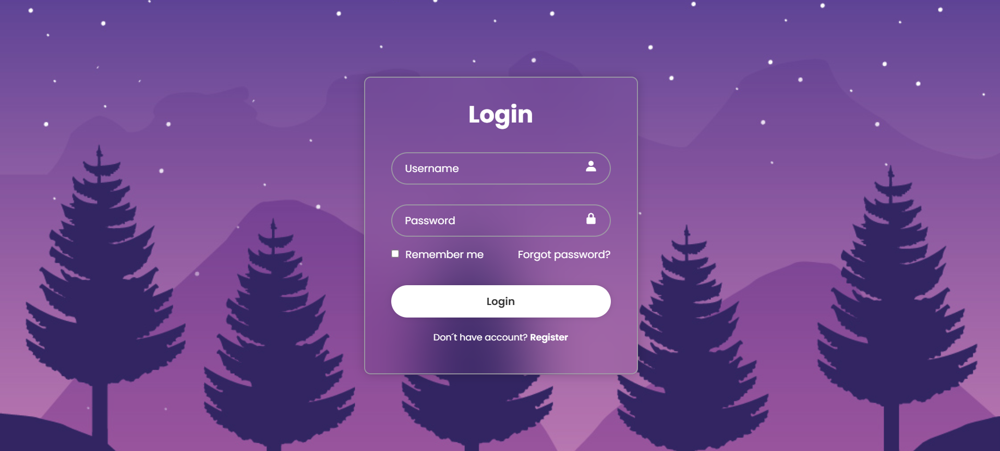

# Responsive Login Page

Uma página de login moderna e responsiva desenvolvida com HTML e CSS.

## 🔗 Demonstração

🌐 https://responsive-login-page-self.vercel.app/

## 📷 Preview

<p align="center">
  
</p>

## 🚀 Tecnologias utilizadas

- HTML5
- CSS3
- Flexbox
- Media Queries
- Boxicons

## ✨ Funcionalidades

- Layout moderno
- Design responsivo
- Campos de usuário e senha
- Checkbox "Remember me"
- Link "Forgot password?"
- Botão de Login
- Interface adaptada para dispositivos móveis

## 📁 Estrutura do projeto

```
responsive-login-page/
│
├── img/
│   ├── img.jpg
│   └── preview.png
│
├── index.html
├── style.css
└── README.md
```

## ▶️ Como executar

1. Clone o repositório

```bash
git clone https://github.com/Luizzhcs/responsive-login-page.git
```

2. Abra o arquivo `index.html` no navegador.

## 📚 Aprendizados

Durante o desenvolvimento deste projeto foram praticados conceitos como:

- Estruturação de formulários em HTML
- Posicionamento com Flexbox
- Posicionamento relativo e absoluto
- Estilização de inputs e botões
- Responsividade utilizando Media Queries
- Organização de arquivos de um projeto Front-end

## 👨‍💻 Autor

Luiz Henrique

- GitHub: https://github.com/Luizzhcs
- LinkedIn: https://www.linkedin.com/in/luiz-henrique-2763aa30b